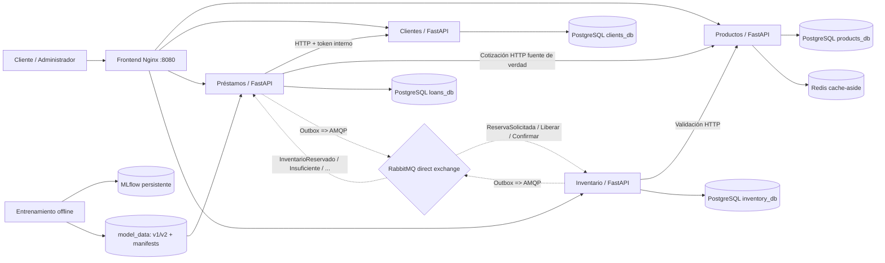
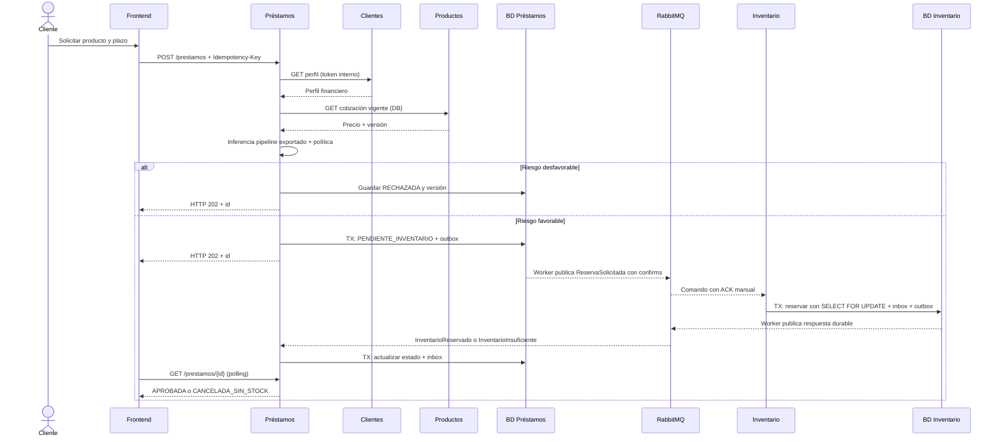
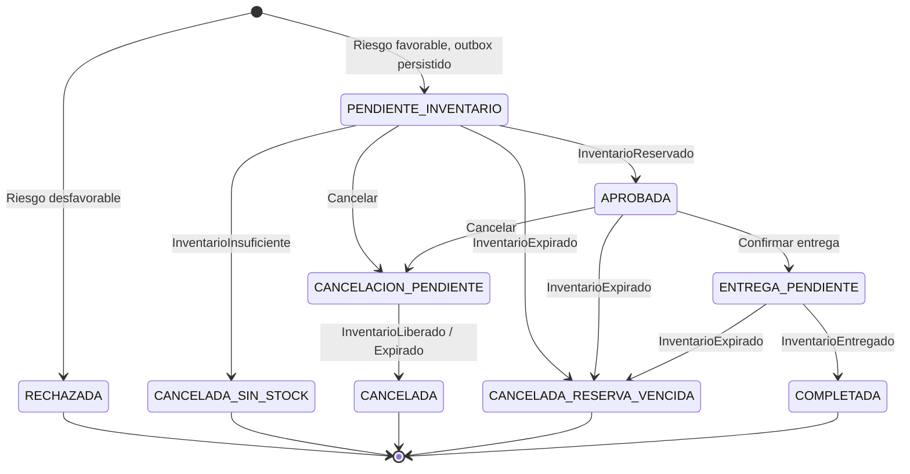

# Arquitectura y consistencia

## Diagrama de componentes

**Líneas continuas:** HTTP / consultas (síncrono) o DB del propio servicio. **Punteadas:** comandos/eventos asíncronos. El navegador NO tiene acceso directo a bases, broker, caché o pipeline.

## Diagrama de secuencia de una solicitud

## Máquina de estados

## Integridad y tiempos

- Consistencia fuerte **local**: solicitud/outbox, inventario/inbox/outbox, préstamo/inbox; las bases no comparten transacciones.
- Consistencia eventual **entre servicios** a través de comandos y eventos. El éxito del riesgo **no** equivale a la aprobación del préstamo.
- Idempotencia HTTP: llave por actor + hash de payload normalizado, índice único SQL; mismo contenido devuelve ID existente, distinto devuelve 409. Debe conservarse la misma llave en reintentos.
- Mensajería: ID único por evento, tabla `inbox(event_id)` en la misma transacción del cambio de negocio. `ACK` solo después del commit.
- Inventario: `SELECT FOR UPDATE` sobre `stock`, restricción `reserved <= quantity` y no negatividad. Reserva con TTL de **300 s**; un worker barre cada 10 s.
- Cancelación antes de reservar: registra `TOMBSTONE` de préstamo; al llegar un comando de reserva tardío no lo ejecuta. Si llega un resultado tardío a Préstamos, no puede reactivarse un estado terminal.
- `PENDIENTE_INVENTARIO` no tiene timeout de broker fijo: ante caída del broker se conserva en la BD + outbox y se reintenta indefinidamente. Se debe observar el estado pendiente y alertar si supera **2 minutos**; la reserva, una vez creada, caduca a los 300 s. Para producción implementar alarma y reconciliación automática de comandos perdidos o DLQ.
- RabbitMQ: mensajes durables, confirmación de publicación, entrega al menos una vez, reintentos limitados, DLQ y supervisión manual.

## Seguridad académica

- PBKDF2-HMAC-SHA256 con sal por cuenta y 250.000 iteraciones; token JWT HS256 expira en 8 horas.
- El rol `admin` se verifica **en cada backend**; cliente solo consulta y cancela préstamos con su `client_id` de JWT. Los datos del cuerpo no sustituyen esa identidad.
- Endpoints internos por token X-Internal-Token solo disponible en contenedores; DB privadas por servicio; puertos de bases no publicados al host.
- `.env` y `ACCESOS_LOCALES.txt` se generan fuera de Git. HTTPS, rotación de secretos, observabilidad distribuida y seguridad de redes adicionales serían necesarios en producción.
