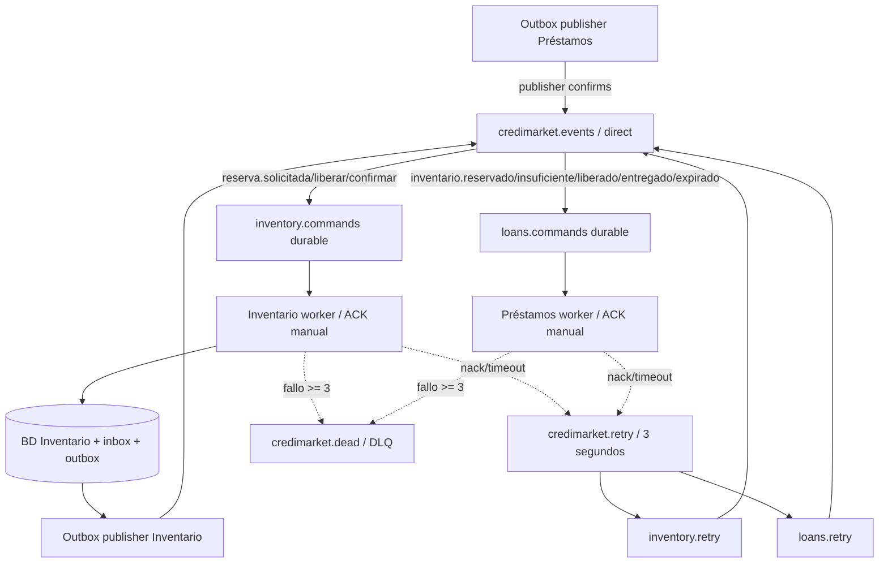

# ADR-001: RabbitMQ frente a Kafka (decisión técnica)

**Estado:** aceptada para esta implementación académica.

**Contexto:** CrediMarket tiene un flujo transaccional de comandos discretos entre dos servicios de negocio. Se estima una demo de hasta cientos de operaciones simultáneas, con uno o pocos consumidores de cada cola. No hay requisito de reconstruir eventos históricos durante días ni almacenar un streaming analítico masivo. La base de datos es el sistema de registro permanente.

## 1. Patrón, volumen y consumidores

**RabbitMQ:** colas de trabajo, enrutamiento directo y confirmación de tareas, adecuado para comandos puntuales de reserva, liberación y confirmación. Dos colas principales: `inventory.commands` y `loans.commands`; un consumidor por cola. Se pueden añadir consumidores **competidores** para escalar, con advertencia de orden y bloqueo por filas SQL. **Kafka:** particiones y grupos de consumidores útiles para flujos enormes, multi-consumidor y relecturas históricas. Sobrecoste no justificado aquí.

## 2. Retención y replay

Con RabbitMQ, mensajes **pendientes** se guardan en cola durable y los fallidos terminan en DLQ para inspección/reinyección manual. No se promete replay histórico arbitrario de mensajes ya confirmados. La auditoría duradera reside en PostgreSQL (`loans`, `movements`, `inbox`, `outbox`). Kafka permitiría retener y reproducir streams durante una ventana explícita, útil si en el futuro varios equipos de analítica y fraude deben consumir datos de forma independiente.

## 3. Distribución y orden

RabbitMQ entrega mensajes a consumidores de una misma cola; `basic_qos(prefetch_count=1)` y un worker por servicio simplifican el orden local durante la demo. **No garantiza orden global entre colas ni entre servicios**. Los eventos tardíos se toleran por la máquina de estados, la fila de reserva y la tabla inbox. En Kafka, el orden se garantiza dentro de una partición, usando `prestamo_id` como clave, pero no entre particiones.

## 4. Errores y duplicados

Exchange principal durable `credimarket.events` (direct), `credimarket.retry` (direct) y `credimarket.dead` (direct). La cola principal usa DLX hacia una cola de espera con TTL 3s que devuelve mensajes a la original; tras 3 intentos fallidos, el consumidor publica en `*.dead` con confirmación y hace ACK. Las colas son durables, mensajes `delivery_mode=2`; los consumidores envían ACK después del commit. Los productores usan publisher confirms + outbox transaccional. La tabla `inbox(event_id)` maneja reentregas sin repetir efectos. Ni Kafka ni RabbitMQ otorgan por sí solos exactamente una operación en PostgreSQL.

## 5. Costos y operación

RabbitMQ se configura con **un** contenedor y un broker simple para la práctica; Kafka necesita brokers, almacenamiento de segmentos, particiones y gestión adicional, aunque hoy existe modo KRaft sin ZooKeeper. En ambos casos se requieren monitorización, recursos y procedimientos de recuperación. RabbitMQ reduce el tiempo de entrega y complejidad para este volumen.

## 6. Cambio de decisión

Si el negocio requiriese **replay auditable multi-día**, retención prolongada, millones de eventos y muchos consumidores independientes para analítica/fraude, introduciríamos Kafka en esa trayectoria. No combinaríamos ambos sin necesidad concreta. Por ahora, cada cambio de estado y movimiento se conserva en la base de datos del servicio correspondiente.

## Topología de RabbitMQ

**Limitación declarada:** DLX en colas clásicas de un solo nodo tiene riesgos en fallos simultáneos del broker. Para garantías más fuertes en producción se emplearían quorum queues y estrategia de dead-lettering at-least-once, respaldos y operación de clúster. Esto se distingue del funcionamiento demostrado en ambiente local de un nodo.
